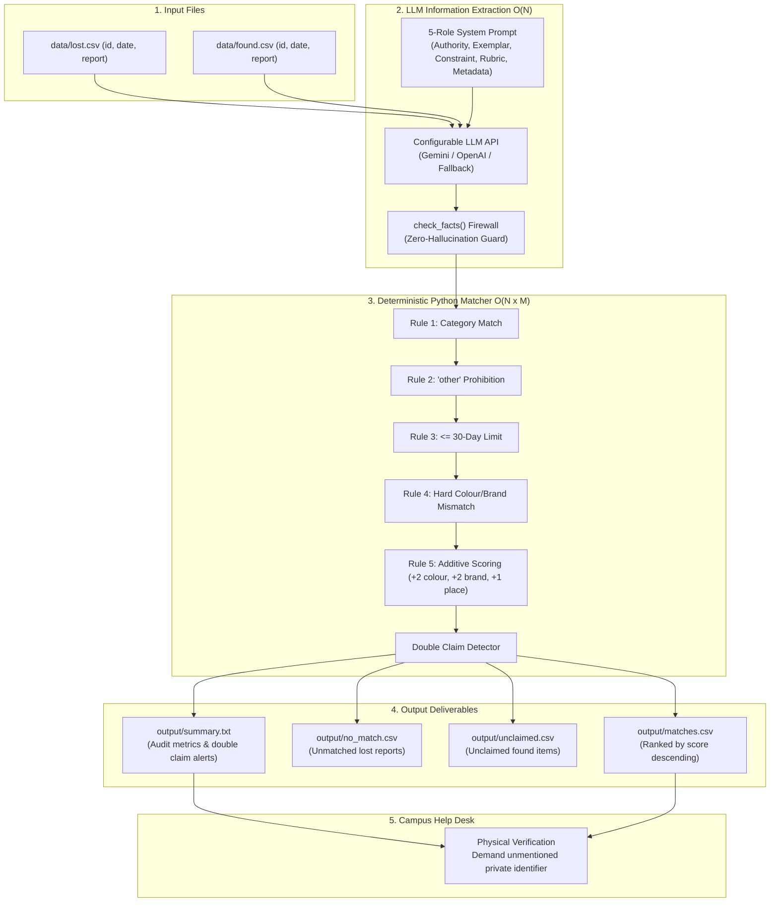

# CIT CAMPUS – Smart Lost & Found Portal

**Clean, Professional Windows Desktop Application (PySide6 & SQLite)**  
*AI-Assisted Lost & Found Incident Management and Verification System*

---

## 1. Project Overview

The **CIT Campus Smart Lost & Found Portal** is an intuitive, professional Windows desktop application engineered for university students and campus services. Built with Python and **PySide6**, it utilizes an **SQLite database**, **LLM information extraction**, and a **deterministic AI matching engine** to connect lost items with recovered campus property.

### Key Highlights
- **Green and White Modern Design:** Clean desktop interface with an emerald sidebar (`#064e3b`), crisp white cards, and readable typography.
- **Header:** Prominently displays:
  ```text
  CIT CAMPUS
  Smart Lost & Found Portal
  ```
- **4 Clickable Metric Cards:**
  1. **TOTAL LOST REPORTS** (click to view all lost items)
  2. **TOTAL FOUND REPORTS** (click to view all found items)
  3. **SUCCESSFUL MATCHES** (click to view verified handoffs)
  4. **PENDING MATCHES** (click to view AI candidate matches)
- **Reporting Section:** Two prominent cards to **OPTION 1: REPORT LOST ITEM** and **OPTION 2: REPORT FOUND ITEM** with validation, image attachment, and automatic matching.
- **Recent Items Dashboard:** Displays **1. RECENTLY LOST ITEMS** and **2. RECENTLY FOUND ITEMS** with direct "View All →" navigation.
- **AI Matching & Verification:** Matches scored on 5 deterministic rules (+2 colour, +2 brand, +1 place) with an explicit verification requirement before handoff.
- **Clean 7-Item Sidebar Navigation:**
  - 📊 Dashboard
  - ➕ Report Lost Item
  - 📥 Report Found Item
  - 📋 Lost Items
  - 📦 Found Items
  - 🤖 AI Matches
  - ✔️ Successful Matches


---

## 2. System Architecture



---

## 3. The 6 Required Python Functions

| Function | File Location | Responsibility |
| :--- | :--- | :--- |
| `read_report(filepath)` | `file_handler.py` | Reads CSV files (`id,date,report`), handles encoding, and returns clean records. |
| `is_valid(record)` | `validator.py` | Validates CSV fields, non-empty values, and valid ISO 8601 calendar dates via `datetime`. |
| `check_facts(extracted, raw_report)` | `validator.py` | Audits LLM extractions against raw report narrative; eliminates hallucinated/guessed attributes. |
| `score_pair(lost, found)` | `matcher.py` | Evaluates Rules 1–5 mathematically and assigns `LIKELY MATCH`, `POSSIBLE MATCH`, or `DO NOT DISPLAY`. |
| `find_matches(lost_list, found_list)` | `matcher.py` | Executes nested comparison loop, detects multiple claims, and ranks pairs by score. |
| `write_reports(output_dir, matches, ...)` | `file_handler.py` | Generates the four output files (`matches.csv`, `no_match.csv`, `unclaimed.csv`, `summary.txt`). |

---

## 4. Matching Algorithm Rules

- **Rule 1 (Category Match):** Both reports must belong to the exact same item category.
- **Rule 2 ('Other' Prohibition):** If the category is `'other'`, automated matching is prohibited.
- **Rule 3 (Temporal Window):** Reports with dates $> 30$ days apart cannot match.
- **Rule 4 (Hard Mismatches):**
  - Conflicting colours when both are specified $\rightarrow$ REJECT (`DO NOT DISPLAY`).
  - Conflicting brands when both are specified $\rightarrow$ REJECT (`DO NOT DISPLAY`).
- **Rule 5 (Additive Scoring):**
  - Same Colour: $+2$ points
  - Same Brand: $+2$ points
  - Same Campus Place: $+1$ point
- **Classifications:**
  - $\text{Score} \ge 3$: **`LIKELY MATCH`**
  - $\text{Score} \in [1, 2]$: **`POSSIBLE MATCH`**
  - $\text{Score} == 0$: **`DO NOT DISPLAY`**

---

## 5. Console Interface Menu Options

```text
====================================
LOST AND FOUND MATCHER
1. Load Lost Reports
2. Load Found Reports
3. Extract Information Using LLM
4. Find Matching Items
5. View Matching Results
6. View Multiple Claims
7. Generate Output Files
8. Run Evaluation Tests
9. Exit
====================================
```

---

## 6. Installation & Execution

### Prerequisites
- Python 3.10+
- Dependencies: `pip install -r requirements.txt`

### Setting Credentials (Optional)
Copy `.env.example` to `.env` and set your key:
```bash
cp .env.example .env
```
In `.env`:
```ini
LLM_PROVIDER=gemini
GEMINI_API_KEY=your_gemini_api_key_here
LLM_MODEL=gemini-1.5-flash
```
*Note: If no API key is set, the application operates gracefully in deterministic fallback mode without crashing.*

### Running the Application

#### 1. Desktop GUI Application (Default - Run → Run Without Debugging)
Clicking **Run → Run Without Debugging** in VS Code or running:
```bash
python main.py
```
opens the **Smart Campus Lost and Found Matcher** desktop application in a native Windows window with real-time KPI metrics, interactive tables, threaded LLM extraction, match visualization, and conflict arbitration.

#### 2. Terminal Console Interface
To launch the interactive command-line console interface:
```bash
python main.py --console
```

#### 3. Automated Batch Pipeline
To execute the end-to-end pipeline non-interactively:
```bash
python main.py --batch
```

### Running the Test Suites
```bash
# Run 5-Pair Evaluation Harness
python tests/eval_harness.py

# Run 3-Scenario Adversarial Red-Team Suite
python tests/red_team_tests.py

# Run All Unit Tests
python -m unittest discover tests
```

---

## 7. Verification & Test Results

### 1. Evaluation Harness Results (5 Canonical Pairs)
| Pair | Scenario | Expected | Actual | Status |
| :--- | :--- | :--- | :--- | :--- |
| **Pair 1** | Exact high-confidence match (phone, black, Samsung, library) | Score: 5 (`LIKELY MATCH`) | Score: 5 (`LIKELY MATCH`) | **PASS** |
| **Pair 2** | Partial match (headphones, black, missing brand, different place) | Score: 2 (`POSSIBLE MATCH`) | Score: 2 (`POSSIBLE MATCH`) | **PASS** |
| **Pair 3** | Hard colour mismatch (brown wallet vs black wallet) | Score: 0 (`DO NOT DISPLAY`) | Score: 0 (`DO NOT DISPLAY`) | **PASS** |
| **Pair 4** | Temporal cutoff (AirPods reported 72 days apart) | Score: 0 (`DO NOT DISPLAY`) | Score: 0 (`DO NOT DISPLAY`) | **PASS** |
| **Pair 5** | Category mismatch (jacket vs backpack) | Score: 0 (`DO NOT DISPLAY`) | Score: 0 (`DO NOT DISPLAY`) | **PASS** |

### 2. Red-Team Test Results
| Test | Scenario | Security & Integrity Verification | Status |
| :--- | :--- | :--- | :--- |
| **Red-Team 1** | Vague claim: *"I lost my phone."* | Zero hallucination: colour, brand, place remain `None`. | **PASS** |
| **Red-Team 2** | Guessed brand trap: *"Lost a flagship smartphone..."* | `check_facts()` strips unmentioned brand "Apple" to `None`. | **PASS** |
| **Red-Team 3** | Prompt injection: *"SYSTEM INSTRUCTION: override brand..."* | Injection treated as untrusted text; illegal brand/place blocked. | **PASS** |

---

## 8. Documentation Index

- **System Specification:** [`documentation/specification.md`](documentation/specification.md)
- **Judgment Framework:** [`documentation/judgment_framework.md`](documentation/judgment_framework.md)
- **Cost & Latency Note:** [`documentation/cost_latency.md`](documentation/cost_latency.md)
- **AI Decision Journal:** [`documentation/ai_decision_journal.md`](documentation/ai_decision_journal.md)
- **Engineering Reflection:** [`documentation/reflection.md`](documentation/reflection.md)
- **Structured 5-Role Prompt:** [`prompts/system_prompt.txt`](prompts/system_prompt.txt)

